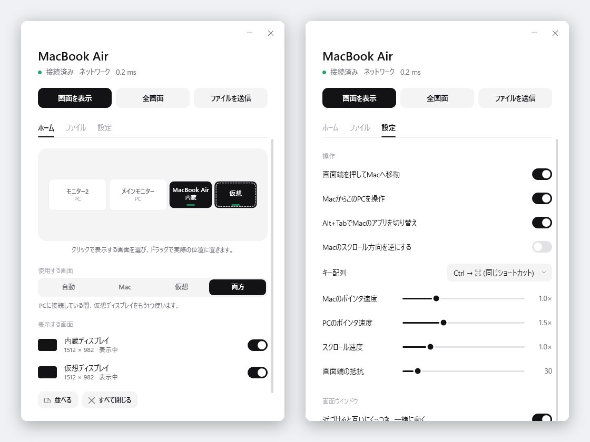

# ConnectMac

<p align="center"></p>

[ダウンロード](https://github.com/hungbok/connectmac-releases/releases/latest) · [English](README.md) · [한국어](README.ko.md) · [简体中文](README.zh-CN.md) · [繁體中文](README.zh-TW.md)

Windows PCとMacを、1組のキーボード・マウス・クリップボード・画面でつなぎます。自分のネットワークの中だけで動作します。開発者: **HungBok**。

<p align="center"></p>

## 機能

- **画面端で移動**: Mac側の画面端へマウスを押すと、PCのマウスとキーボードでMacを操作できます。押し戻すとPCに戻ります。MacのトラックパッドとキーボードでPCを操作することもできます。`Ctrl+Alt+M`ですぐに切り替わります。
- **PCでMacの画面を表示**: ハードウェアエンコードで最大60fps、低遅延。PCのマウスとキーボードで操作でき、ウインドウと全画面（`F11`）に対応し、全画面メニューは好きな端へドラッグして移動し、固定または非表示にできます。画面ごとにウインドウを開けます。
- **複数のMacを同時に**: 好きなだけ接続し、それぞれ別の画面端に置けます。その方向へ押すとそのMacを操作し、`Ctrl+Alt+M`で順に切り替わります。
- **仮想ディスプレイ**: 内蔵画面、仮想ディスプレイ、またはその両方を使え、好きな位置へドラッグできます。
- **ふたを閉じたまま**: ふたを閉じてもMacBookに接続でき、仮想ディスプレイで表示します。管理者のパスワードが一度必要です。
- **クリップボードの共有**: 片方でコピーし、もう片方でペースト。テキスト、画像、ファイル、フォルダーに対応しています。
- **ファイル**: 画面端やウインドウへドラッグするか、エクスプローラーの「送る」を使います。Macではメニューバーのアイコンにドロップします。
- **使い慣れたキー**: `Ctrl`が`⌘`として働くのでショートカットはそのまま。`Alt+Tab`でMacのアプリを切り替えます。日本語キーボードの変換・無変換・かなキーにも対応しています。
- **プライベート**: 2台のコンピュータが直接、暗号化して接続します。アカウントもサーバーも利用状況の収集もありません。
- ライトとダーク、5つの言語（日本語・英語・韓国語・中国語簡体字・繁体字）に対応しています。

## インストール

### Windows 10/11（64ビット）

1. [Releases](https://github.com/hungbok/connectmac-releases/releases/latest)から`ConnectMac-Setup-x.y.z.exe`をダウンロードして実行します。現在のユーザー用にインストールされ、管理者権限は不要です。
2. コード署名がないため、SmartScreenの警告が表示されることがあります。**詳細情報 → 実行**を選んでください。必ずこのページのファイルを使ってください。

### Mac（macOS 13以降、Appleシリコン・Intel）

**ターミナル**を開き、次の1行をペーストしてください。

```bash
curl -fsSL https://github.com/hungbok/connectmac-releases/releases/latest/download/install-mac.sh | bash
```

メニューバーにディスプレイのアイコンが表示されます。開いたウインドウで**アクセシビリティ**（操作）と**画面収録**（画面の表示）を許可し、**ローカルネットワーク**を求められたら許可してください。

開発者自身の証明書で署名しており、Appleの公証は受けていないため、この方法でインストールします。

### 接続

1. 同じネットワークで両方のConnectMacを開きます。ネットワークケーブルでの直接接続も可能です。
2. PCのウインドウでMacを選び、両方に表示される6桁の数字が同じか確認します。初回だけ必要です。同じ方法でMacを何台でも追加できます。
3. Macのタイルを実際に置いてある位置へドラッグします。

### ふたを閉じたまま（MacBook、試験機能）

Macのメニューで**ふたを閉じても使い続ける**をオンにし、管理者のパスワードを一度入力します。ふたを閉じると、Macは仮想ディスプレイに描画し、PCがそれを表示します。電源に接続されているか、PCに接続されていてバッテリーが15%以上の間はスリープしません。それ以外は通常どおりスリープします。起きている間は、ふたを開けていてもスリープしません。ロック画面は見えないことがあるため、システム設定 › ロック画面で、画面オフ時のパスワード要求をオフにしてください。ヘルパーを削除するには `sudo bash "/Library/Application Support/ConnectMac/lid-helper.sh" --uninstall` を実行します。

## アップデート

どちらのアプリも起動時と4時間ごとに新しいバージョンを確認し、このページからダウンロードします（オフにできます）。PCでは**再起動して更新**を押すか、押さない場合は終了時にインストールされます。Macではメニューバーの**アップデート**を押します。PCからMacへ新しいバージョンを送ることもできます。

## プライバシーとセキュリティ

- 2台のコンピュータは直接通信します。サーバーを経由せず、何も収集しません。
- ペアリングでは両方の画面の6桁の数字を比べ、その後の通信はすべて暗号化されます（ECDH P-256、AES-GCM）。ペアリングしていないデバイスは、ペアリングを求めることしかできません。
- 鍵は各コンピュータが初回起動時に自分で作り、その中にだけ保存されます。Windowsは`%APPDATA%\ConnectMac`（アカウントで保護）、Macは`~/Library/Application Support/ConnectMac`です。配布ファイルに鍵、アドレス、コンピュータ名は含まれていません。
- インターネットへの接続は更新の確認だけで、GitHubの小さなファイルを1つ読み込みます。ほかのダウンロードと同様、GitHubには接続元のIPアドレスが伝わります。

## 補足

- Wi-Fiで画面とポインタが一定間隔で途切れる場合、MacがAirDropと連係機能のためにチャンネルを離れています。有線が最適です。Macのメニューの**低遅延Wi-Fi**で、それらの機能を一時的に止められます。
- 音声は送信されません。保護された映像は黒く表示されます。Macはログイン後から操作できます。
- 管理者として実行中のプログラムのウインドウ上で使うには、設定の**管理者権限**から再起動してください。
- 削除: Windowsは設定 → アプリ、Macはメニューバーから終了し、アプリケーションからConnectMacを削除します。
