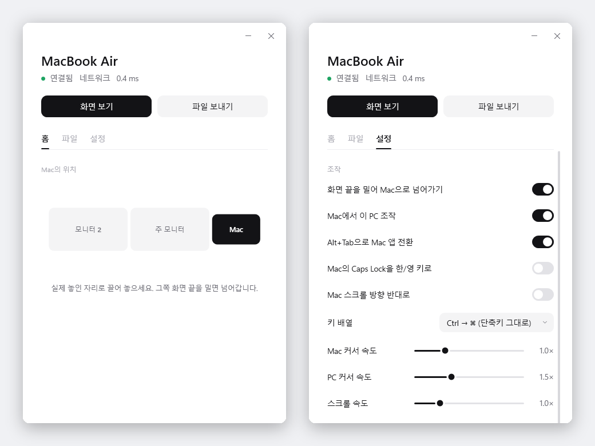

# ConnectMac

<p align="center"></p>

[다운로드](https://github.com/hungbok/connectmac-releases/releases/latest) · [English](README.md) · [日本語](README.ja.md) · [简体中文](README.zh-CN.md) · [繁體中文](README.zh-TW.md)

Windows PC와 Mac을 키보드·마우스·클립보드·화면 하나로 이어 줍니다. 내 네트워크 안에서만 연결됩니다. 개발자: **HungBok**.

<p align="center"></p>

## 기능

- **화면 끝으로 넘어가기**: Mac 쪽 화면 끝으로 마우스를 밀면 PC의 마우스와 키보드로 Mac을 조작합니다. 반대로 밀면 돌아옵니다. Mac의 트랙패드와 키보드로 PC를 조작할 수도 있습니다. `Ctrl+Alt+M`으로 바로 전환합니다.
- **PC에서 Mac 화면 보기**: 하드웨어 인코딩으로 최대 60fps, 짧은 지연으로 보여 줍니다. PC의 마우스와 키보드로 조작하며 창과 전체 화면(`F11`)을 지원하며, 전체 화면 메뉴는 원하는 가장자리로 끌어 옮기고 고정하거나 숨길 수 있습니다. 화면마다 창을 열 수 있고, 창끼리 붙여 함께 움직이고 함께 전체 화면으로 볼 수 있습니다.
- **여러 Mac 동시 연결**: 원하는 만큼 연결하고 각각 다른 가장자리에 놓습니다. 그쪽으로 밀면 그 Mac을 조작하고, `Ctrl+Alt+M`으로 차례로 넘어갑니다.
- **가상 디스플레이**: 내장 화면, 가상 디스플레이, 또는 둘 다 쓸 수 있고 원하는 자리로 끌어 놓습니다.
- **덮개를 닫은 상태**: 덮개를 닫아도 MacBook에 계속 접속할 수 있고 가상 화면으로 보여 줍니다. 관리자 암호가 한 번 필요합니다.
- **클립보드 공유**: 한쪽에서 복사하고 다른 쪽에서 붙여 넣습니다. 글, 그림, 파일, 폴더를 지원합니다.
- **파일**: 화면 끝이나 창으로 끌어 놓거나 탐색기의 '보내기'를 씁니다. Mac에서는 메뉴 막대 아이콘에 놓습니다.
- **맞춰진 키**: `Ctrl`이 `⌘`로 동작해 단축키를 그대로 쓰고, `Alt+Tab`으로 Mac 앱을 전환합니다. 한/영 키도 됩니다. Mac 자리 배열도 고를 수 있습니다.
- **개인적인 연결**: 두 컴퓨터가 직접 암호화해서 연결합니다. 계정, 서버, 사용 정보 수집이 없습니다.
- 밝은 화면과 어두운 화면, 5개 언어(한국어·영어·일본어·중국어 간체·번체)를 지원합니다.

## 설치

### Windows 10/11 (64비트)

1. [Releases](https://github.com/hungbok/connectmac-releases/releases/latest)에서 `ConnectMac-Setup-x.y.z.exe`를 받아 실행합니다. 현재 사용자용으로 설치되며 관리자 권한이 필요 없습니다.
2. 코드 서명이 없어 SmartScreen 안내가 나올 수 있습니다. **추가 정보 → 실행**을 누르세요. 이 페이지에서 받은 파일만 사용하세요.

### Mac (macOS 13 이상, Apple Silicon·Intel)

**터미널**을 열고 아래 한 줄을 붙여 넣으세요.

```bash
curl -fsSL https://github.com/hungbok/connectmac-releases/releases/latest/download/install-mac.sh | bash
```

메뉴 막대에 모니터 모양 아이콘이 생깁니다. 열리는 창에서 **손쉬운 사용**(조작)과 **화면 기록**(화면 보기)을 허용하고, **로컬 네트워크**를 물으면 허용하세요.

개발자의 자체 인증서로 서명되어 있고 Apple 공증은 받지 않아 이 방법으로 설치합니다.

### 연결

1. 같은 네트워크에서 양쪽의 ConnectMac을 엽니다. 네트워크 케이블로 직접 연결해도 됩니다.
2. PC 창에서 Mac을 고르고 양쪽의 숫자 여섯 자리가 같은지 확인합니다. 처음 한 번만 하면 됩니다. 같은 방법으로 Mac을 여러 대 추가할 수 있습니다.
3. 홈의 그림에서 Mac을 실제 놓인 자리로 끌어 놓고, 볼 화면을 누릅니다.

### 덮개를 닫은 상태 (MacBook, 시험 기능)

Mac 메뉴의 **덮개를 닫아도 계속 사용**을 켜고 관리자 암호를 한 번 입력합니다. 덮개를 닫으면 Mac이 가상 화면에 그리고 PC가 그 화면을 보여 줍니다. 전원에 연결되어 있거나, PC와 연결되어 있고 배터리가 15% 이상이면 잠들지 않으며, 그렇지 않으면 평소처럼 잠듭니다. 깨어 있는 동안에는 덮개를 열어 둔 상태에서도 잠들지 않습니다. 잠긴 화면은 보이지 않을 수 있으니 시스템 설정 › 잠금 화면에서 화면이 꺼질 때 암호를 요구하지 않도록 바꾸세요. 도우미를 없애려면 `sudo bash "/Library/Application Support/ConnectMac/lid-helper.sh" --uninstall`을 실행합니다.

## 업데이트

두 앱은 시작할 때와 4시간마다 새 버전을 확인하고 이 페이지에서 받습니다(끌 수 있습니다). PC에서는 **다시 시작하여 업데이트**를 누르거나, 누르지 않으면 종료할 때 설치됩니다. Mac에서는 메뉴 막대의 **업데이트**를 누릅니다. PC에서 Mac으로 새 버전을 보낼 수도 있습니다.

## 개인정보와 보안

- 두 컴퓨터가 직접 통신합니다. 서버를 거치지 않으며 아무것도 수집하지 않습니다.
- 페어링할 때 양쪽 화면의 숫자 여섯 자리를 비교하고, 그 뒤의 통신은 모두 암호화됩니다(ECDH P-256, AES-GCM). 페어링하지 않은 기기는 페어링을 요청할 수만 있습니다.
- 키는 각 컴퓨터가 처음 실행될 때 스스로 만들고 그 안에만 있습니다. Windows는 `%APPDATA%\ConnectMac`(사용자 계정으로 보호), Mac은 `~/Library/Application Support/ConnectMac`입니다. 배포 파일에는 키, 주소, 컴퓨터 이름이 들어 있지 않습니다.
- 인터넷 연결은 업데이트 확인뿐이며 GitHub의 작은 파일 하나를 읽습니다. 다른 다운로드와 마찬가지로 GitHub는 접속한 IP 주소를 알 수 있습니다.

## 알아 두기

- Wi-Fi에서 화면과 포인터가 일정한 간격으로 끊기면 Mac이 AirDrop과 연속성을 위해 채널을 옮기는 것입니다. 유선이 가장 좋고, Mac 메뉴의 **저지연 Wi-Fi**로 그 기능을 잠시 끌 수 있습니다.
- 소리는 보내지 않습니다. 보호된 영상은 검게 나옵니다. Mac은 로그인한 뒤부터 조작할 수 있습니다.
- 관리자 권한으로 실행된 프로그램의 창 위에서 쓰려면 설정의 **관리자 권한**으로 다시 시작하세요.
- 제거: Windows는 설정 → 앱, Mac은 메뉴 막대에서 종료한 뒤 응용 프로그램에서 ConnectMac을 지웁니다.
