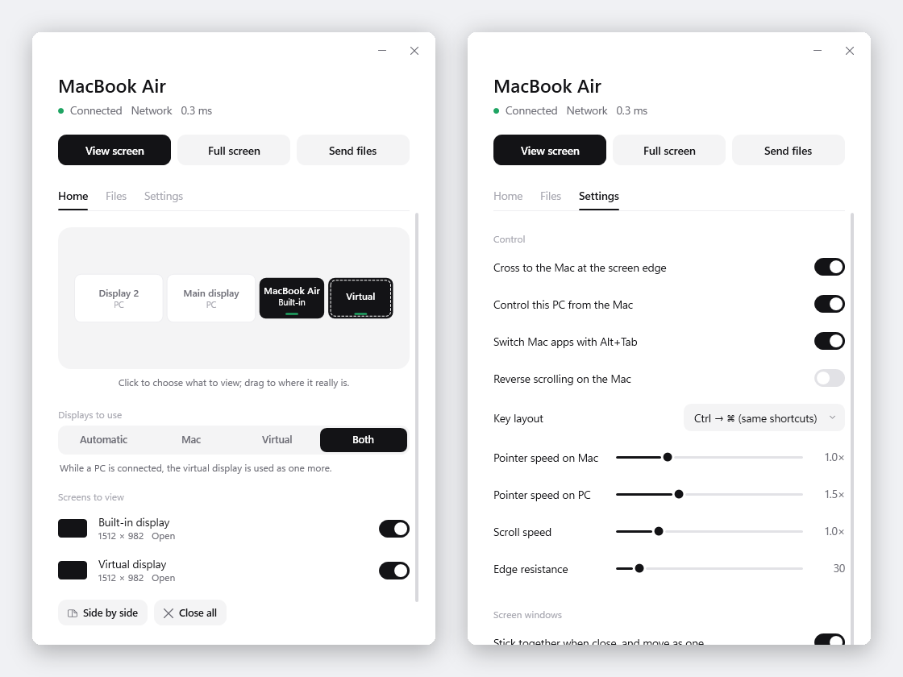

# ConnectMac

<p align="center"></p>

[Download](https://github.com/hungbok/connectmac-releases/releases/latest) · [한국어](README.ko.md) · [日本語](README.ja.md) · [简体中文](README.zh-CN.md) · [繁體中文](README.zh-TW.md)

One keyboard, mouse, clipboard and screen for a Windows PC and a Mac, over your own network. Developed by **HungBok**.

<p align="center"></p>

## Features

- **Cross at the screen edge**: push the pointer through the edge that faces the Mac, and the PC's mouse and keyboard control the Mac. Push back to return. The Mac's trackpad and keyboard can control the PC the same way. `Ctrl+Alt+M` switches at once.
- **The Mac's screen on the PC**: up to 60 fps with hardware encoding, with low delay. Control it with the PC's mouse and keyboard, in a window or in full screen (`F11`).
- **Shared clipboard**: copy on one, paste on the other. Text, pictures, files and folders.
- **Files**: drag them to the screen edge, into the window, or use Explorer's "Send to". On the Mac, drop them on the menu bar icon.
- **Keys that fit**: `Ctrl` works as `⌘`, so shortcuts stay the same; `Alt+Tab` switches Mac apps. The physical Mac layout is available too.
- **Private**: a direct, encrypted connection between your two computers. No account, no server, no telemetry.
- Light and dark, and five languages: English, Korean, Japanese, Simplified and Traditional Chinese.

## Install

### Windows 10/11 (64-bit)

1. Download `ConnectMac-Setup-x.y.z.exe` from [Releases](https://github.com/hungbok/connectmac-releases/releases/latest) and run it. It installs for your user account and needs no administrator.
2. The installer is not code-signed, so Windows SmartScreen may warn about an unknown publisher: choose **More info → Run anyway**. Only use files from this page.

### Mac (macOS 13 or later, Apple silicon and Intel)

Open **Terminal** and paste this line:

```bash
curl -fsSL https://github.com/hungbok/connectmac-releases/releases/latest/download/install-mac.sh | bash
```

A display icon appears in the menu bar. Allow **Accessibility** (to control the Mac) and **Screen Recording** (to show its screen) in the window that opens, and the **local network** when asked.

The app is signed with the developer's own certificate and is not notarized by Apple, which is why it is installed this way.

### Connect

1. Open ConnectMac on both, on the same network. A direct network cable works as well.
2. Choose the Mac in the PC's window and check that both show the same six digits. This is only needed once.
3. Drag the Mac's tile to where it stands next to your monitors.

## Updates

Both apps look for a new version at start and every four hours and download it from this page; you can turn this off. On the PC choose **Restart to update**, or it is installed when you quit. On the Mac choose **Update** in the menu bar. The PC can also send the new version to the Mac.

## Privacy and security

- The two computers talk to each other directly. Nothing goes through a server, and nothing is collected.
- Pairing compares six digits on both screens; everything after that is encrypted (ECDH P-256, AES-GCM). Devices that are not paired can only ask to be.
- Each computer makes its own keys at first start, and they stay there: `%APPDATA%\ConnectMac` on Windows (protected for your account) and `~/Library/Application Support/ConnectMac` on the Mac. The download contains no keys, addresses or computer names.
- The only connection to the internet is the update check, which reads one small file from GitHub. As with any download, GitHub sees the address it comes from.

## Good to know

- If picture and pointer stall at regular intervals on Wi-Fi, the Mac is leaving its channel for AirDrop and Continuity. A cable is best; **Low-latency Wi-Fi** in the Mac's menu pauses those features.
- Sound is not sent. Protected video is black. The Mac can be controlled once you have logged in to it.
- To control windows of programs that run as administrator, restart ConnectMac with **Administrator rights** in the settings.
- To remove it: Windows Settings → Apps; on the Mac, quit it from the menu bar and delete ConnectMac from Applications.
