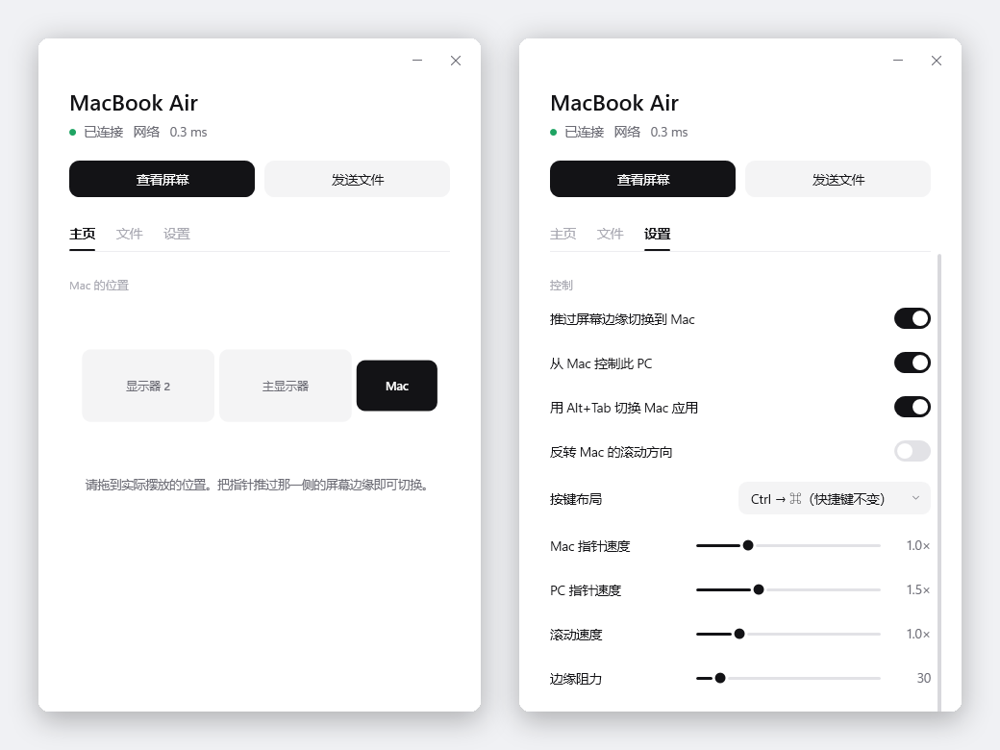

# ConnectMac

<p align="center"></p>

[下载](https://github.com/hungbok/connectmac-releases/releases/latest) · [English](README.md) · [한국어](README.ko.md) · [日本語](README.ja.md) · [繁體中文](README.zh-TW.md)

用一套键盘、鼠标、剪贴板和屏幕连接 Windows PC 与 Mac，只在您自己的网络中运行。开发者：**HungBok**。

<p align="center"></p>

## 功能

- **推过屏幕边缘**：把指针推过朝向 Mac 的屏幕边缘，即可用 PC 的鼠标和键盘控制 Mac，推回来就返回。也可以用 Mac 的触控板和键盘控制 PC。`Ctrl+Alt+M` 可立即切换。
- **在 PC 上查看 Mac 屏幕**：硬件编码，最高 60 fps，低延迟。可用 PC 的鼠标和键盘控制，支持窗口和全屏（`F11`），全屏菜单可拖动到任意边缘，并可固定或隐藏。每个屏幕都可以有自己的窗口。
- **同时连接多台 Mac**：可连接任意多台，并分别放在不同的屏幕边缘。向某个方向推即可控制那台 Mac，`Ctrl+Alt+M` 依次切换。
- **虚拟显示器**：可使用 Mac 屏幕、虚拟显示器或两者同时使用，并拖到想要的位置。
- **合盖状态**：MacBook 合上盖子后仍可访问，并通过虚拟显示器显示画面。需要输入一次管理员密码。
- **共享剪贴板**：在一台上复制，在另一台上粘贴。支持文字、图片、文件和文件夹。
- **文件**：拖到屏幕边缘或窗口中，或使用资源管理器的“发送到”。在 Mac 上拖放到菜单栏图标。
- **顺手的按键**：`Ctrl` 相当于 `⌘`，快捷键保持不变；`Alt+Tab` 切换 Mac 应用。也可选择 Mac 的按键位置。
- **私密**：两台电脑之间直接加密连接。没有账号、没有服务器、不收集使用数据。
- 支持浅色和深色，以及五种语言：简体中文、繁体中文、英语、日语、韩语。

## 安装

### Windows 10/11（64 位）

1. 从 [Releases](https://github.com/hungbok/connectmac-releases/releases/latest) 下载并运行 `ConnectMac-Setup-x.y.z.exe`。仅为当前用户安装，无需管理员权限。
2. 安装程序没有代码签名，SmartScreen 可能提示未知发布者：选择 **更多信息 → 仍要运行**。请只使用本页面的文件。

### Mac（macOS 13 或更高版本，Apple 芯片和 Intel）

打开**终端**，粘贴下面这一行：

```bash
curl -fsSL https://github.com/hungbok/connectmac-releases/releases/latest/download/install-mac.sh | bash
```

菜单栏中会出现显示器图标。请在打开的窗口中允许**辅助功能**（用于控制）和**屏幕录制**（用于查看屏幕），并在询问时允许**本地网络**。

应用使用开发者自己的证书签名，未经 Apple 公证，因此采用这种安装方式。

### 连接

1. 在同一网络中打开两边的 ConnectMac，也可以用网线直连。
2. 在 PC 窗口中选择 Mac，确认两边的六位数字一致。只需进行一次。可用同样的方法添加任意多台 Mac。
3. 将 Mac 方块拖到实际摆放的位置。

### 合盖状态（MacBook，实验功能）

在 Mac 菜单中打开**合盖时继续使用**，输入一次管理员密码。合上盖子后，Mac 在虚拟显示器上绘制画面，由 PC 显示。接通电源，或已连接 PC 且电池电量在 15% 以上时不会睡眠；其他情况照常睡眠。保持唤醒期间，即使打开盖子也不会睡眠。锁定的屏幕可能无法看到，建议在 系统设置 › 锁定屏幕 中关闭屏幕关闭后要求密码。若要移除辅助程序，请运行 `sudo bash "/Library/Application Support/ConnectMac/lid-helper.sh" --uninstall`。

## 更新

两个应用会在启动时以及每四小时检查新版本，并从本页面下载（可关闭）。在 PC 上点按**重新启动以更新**，否则会在退出时安装。在 Mac 上点按菜单栏中的**更新**。也可以由 PC 将新版本发送到 Mac。

## 隐私与安全

- 两台电脑直接通信，不经过服务器，也不收集任何信息。
- 配对时核对两边屏幕上的六位数字，此后的通信全部加密（ECDH P-256、AES-GCM）。未配对的设备只能请求配对。
- 密钥由每台电脑在首次启动时自行生成，并只保存在本机：Windows 为 `%APPDATA%\ConnectMac`（由您的账户保护），Mac 为 `~/Library/Application Support/ConnectMac`。下载文件中不包含任何密钥、地址或电脑名称。
- 唯一的互联网连接是检查更新，只读取 GitHub 上的一个小文件。与任何下载一样，GitHub 会看到访问来源的 IP 地址。

## 说明

- 如果在 Wi-Fi 下画面和指针有规律地卡顿，是 Mac 为隔空投送和连续互通离开了信道。有线连接最佳；也可以用 Mac 菜单中的**低延迟 Wi-Fi** 暂停这些功能。
- 不传输声音。受保护的视频会显示为黑色。登录 Mac 之后才能控制。
- 若要在以管理员身份运行的程序窗口上使用，请在设置中以**管理员权限**重新启动。
- 卸载：Windows 在 设置 → 应用；Mac 在菜单栏退出后，从“应用程序”中删除 ConnectMac。
