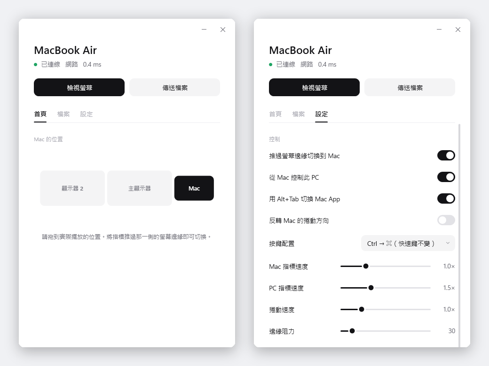

# ConnectMac

<p align="center"></p>

[下載](https://github.com/hungbok/connectmac-releases/releases/latest) · [English](README.md) · [한국어](README.ko.md) · [日本語](README.ja.md) · [简体中文](README.zh-CN.md)

用一組鍵盤、滑鼠、剪貼簿和螢幕連接 Windows PC 與 Mac，只在您自己的網路中運作。開發者：**HungBok**。

<p align="center"></p>

## 功能

- **推過螢幕邊緣**：將指標推過朝向 Mac 的螢幕邊緣，即可用 PC 的滑鼠和鍵盤控制 Mac，推回來就返回。也可以用 Mac 的觸控式軌跡板和鍵盤控制 PC。`Ctrl+Alt+M` 可立即切換。
- **在 PC 上檢視 Mac 螢幕**：硬體編碼，最高 60 fps，低延遲。可用 PC 的滑鼠和鍵盤控制，支援視窗和全螢幕（`F11`）。
- **共享剪貼簿**：在一台上拷貝，在另一台上貼上。支援文字、圖片、檔案和資料夾。
- **檔案**：拖到螢幕邊緣或視窗中，或使用檔案總管的「傳送到」。在 Mac 上拖放到選單列圖示。
- **順手的按鍵**：`Ctrl` 相當於 `⌘`，快速鍵維持不變；`Alt+Tab` 切換 Mac App。也可選擇 Mac 的按鍵位置。
- **私密**：兩台電腦之間直接加密連線。沒有帳號、沒有伺服器、不收集使用資料。
- 支援淺色和深色，以及五種語言：繁體中文、簡體中文、英文、日文、韓文。

## 安裝

### Windows 10/11（64 位元）

1. 從 [Releases](https://github.com/hungbok/connectmac-releases/releases/latest) 下載並執行 `ConnectMac-Setup-x.y.z.exe`。僅為目前使用者安裝，不需要系統管理員權限。
2. 安裝程式沒有程式碼簽章，SmartScreen 可能提示未知的發行者：選擇 **其他資訊 → 仍要執行**。請只使用本頁面的檔案。

### Mac（macOS 13 或更新版本，Apple 晶片和 Intel）

開啟**終端機**，貼上下面這一行：

```bash
curl -fsSL https://github.com/hungbok/connectmac-releases/releases/latest/download/install-mac.sh | bash
```

選單列中會出現顯示器圖示。請在開啟的視窗中允許**輔助使用**（用於控制）和**螢幕錄製**（用於檢視螢幕），並在詢問時允許**區域網路**。

App 使用開發者自己的憑證簽署，未經 Apple 公證，因此採用這種安裝方式。

### 連線

1. 在同一網路中開啟兩邊的 ConnectMac，也可以用網路線直接連接。
2. 在 PC 視窗中選擇 Mac，確認兩邊的六位數字一致。只需進行一次。
3. 將 Mac 方塊拖到實際擺放的位置。

## 更新

兩個 App 會在啟動時以及每四小時檢查新版本，並從本頁面下載（可關閉）。在 PC 上按**重新啟動以更新**，否則會在結束時安裝。在 Mac 上按選單列中的**更新**。也可以由 PC 將新版本傳送到 Mac。

## 隱私與安全

- 兩台電腦直接通訊，不經過伺服器，也不收集任何資訊。
- 配對時核對兩邊螢幕上的六位數字，此後的通訊全部加密（ECDH P-256、AES-GCM）。未配對的裝置只能要求配對。
- 金鑰由每台電腦在首次啟動時自行產生，並只保存在本機：Windows 為 `%APPDATA%\ConnectMac`（由您的帳號保護），Mac 為 `~/Library/Application Support/ConnectMac`。下載檔案中不包含任何金鑰、位址或電腦名稱。
- 唯一的網際網路連線是檢查更新，只讀取 GitHub 上的一個小檔案。與任何下載一樣，GitHub 會看到連線來源的 IP 位址。

## 說明

- 如果在 Wi-Fi 下畫面和指標有規律地停頓，是 Mac 為 AirDrop 和接續互通離開了頻道。有線連線最佳；也可以用 Mac 選單中的**低延遲 Wi-Fi** 暫停這些功能。
- 不傳輸聲音。受保護的影片會顯示為黑色。登入 Mac 之後才能控制。
- 若要在以系統管理員身分執行的程式視窗上使用，請在設定中以**系統管理員權限**重新啟動。
- 解除安裝：Windows 在 設定 → 應用程式；Mac 在選單列結束後，從「應用程式」中刪除 ConnectMac。
